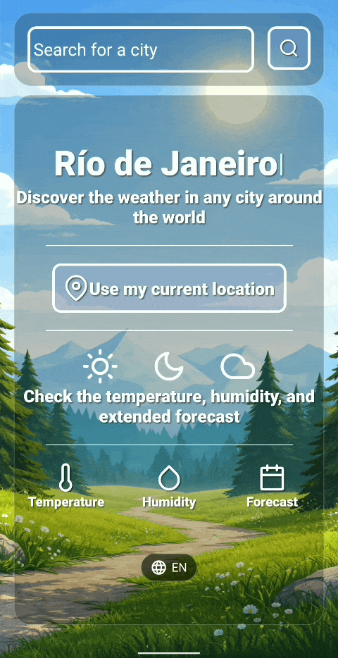
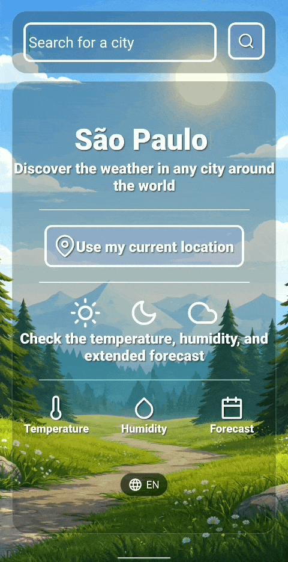

# Weather App

[](https://github.com/Mariano138/Weather-App/actions/workflows/ci.yml)

A simple weather application built with React Native and Expo that allows users to search for cities and view current weather conditions and forecast.


## Screenshots

| Home | Weather |
| --- | --- |
|  |  |

## Key Features

- **City Search & Suggestions**
   * Search for weather information by city with suggestions while typing.
- **Dynamic Weather Backgrounds**
    * Backgrounds that automatically adapt to each city's current weather conditions and time of day.
- **Internationalization**
    * English and Spanish through `i18next` / `react-i18next`.
- **Current Weather & Forecasts**
- **Geolocation**
- **Efficient Data Fetching & Caching with TanStack Query**
- **Skeleton Loading UI**


## Built With

- React Native
- Expo
- TypeScript
- Expo Router
- TanStack Query
- Expo Location
- i18next & react-i18next
- React Native Reanimated
- React Content Loader
- Vercel Serverless Functions
- OpenWeather API


## Getting Started

To clone and run this application, you'll need Git and Node.js (which comes with npm) installed on your computer. From your command line:

```bash
# Clone this repository
$ git clone https://github.com/Mariano138/Weather-App.git

# Go into the repository
$ cd Weather-App

# Install dependencies
$ npm install

# Run the app
$ npx expo start
```

> **Note** You can run the app using Expo Go on your mobile device or an Android/iOS development environment.

## Testing

The project uses Jest with `jest-expo`. The tests cover the weather service and utility functions.

```bash
# Run the test suite
npm test

# Run in watch mode
npm run test:watch
```

Every push and pull request runs type checking, linting and tests through GitHub Actions.

## Backend & API
- OpenWeather API 
    - Provides current weather conditions and forecast data.
- Vercel Serverless Functions 
    - Handles weather API requests and keeps the API key on the server.
- Response Caching 
    - Reduces unnecessary external API requests and improves response times.

## Author

Mariano Agüero

- GitHub: [@Mariano138](https://github.com/Mariano138)
